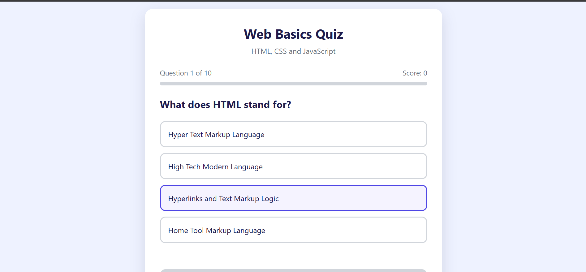
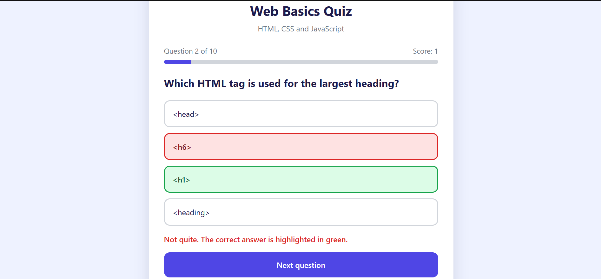
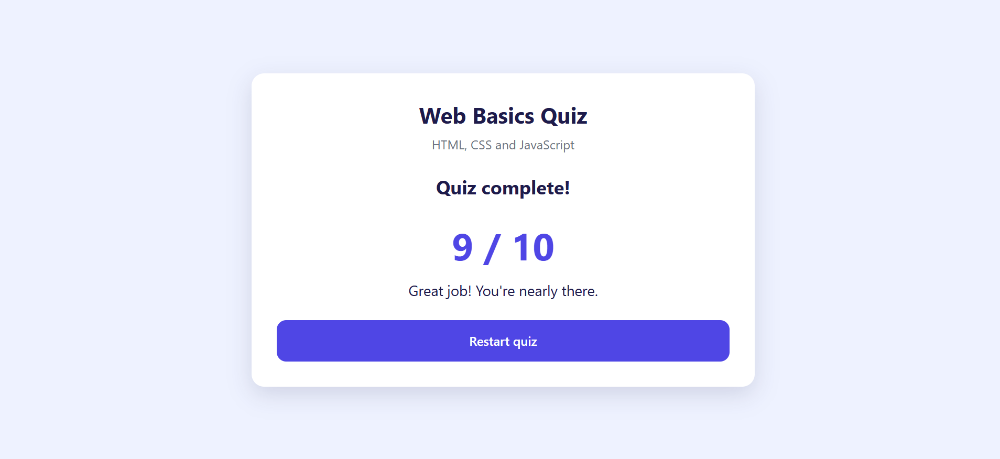
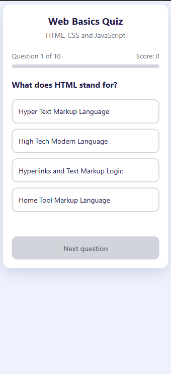

# Web Basics Quiz

A 10-question multiple-choice quiz on HTML, CSS and JavaScript, built with plain HTML, CSS and vanilla JavaScript. No frameworks and no build step.

**Live demo:** https://laprimus.github.io/Quiz-App/



## Features

- **10 questions** stored in an array of objects, each with a `question`, a list of `options` and the index of the `correct` answer.
- **One question at a time**, with a progress bar and a running score.
- **Instant feedback:** your choice turns green if it is right, or red if it is wrong, and the correct answer is also shown in green. The options then lock.
- **Next button** that stays disabled until you answer, and changes to "See result" on the last question.
- **Result screen** with your score and a message that depends on how well you did.
- **Restart button** that resets the score and starts again from question 1.
- **Responsive layout** that works on phones, with full-width, tap-sized buttons.

## Screenshots

| Right and wrong answers | Result screen | On a phone |
| --- | --- | --- |
|  |  |  |

## How it works

| Percentage correct | Message |
| --- | --- |
| 100% | Perfect score |
| 80% to 99% | Great job |
| 50% to 79% | Good effort |
| Below 50% | Keep going |

- A `for` loop builds one button for each option of the current question.
- A `forEach` loop then locks every button and colours the right and wrong ones.
- `if` / `else` checks the chosen answer, and an `if` / `else if` chain picks the result message.

## Built with

- HTML5
- CSS3 (custom properties, Flexbox, media queries)
- Vanilla JavaScript (DOM manipulation and event listeners)

## Project structure

```
quiz-app/
├── index.html
├── css/
│   └── style.css
├── js/
│   └── quiz.js
├── screenshots/
└── README.md
```

## Run it locally

1. Clone or download this repository.
2. Open `index.html` in your browser.

There is nothing to install.

## Make your own quiz

The questions are at the top of `js/quiz.js`. Add, remove or edit objects in the `questions` array. `correct` is the position of the right option, counting from 0.

```js
{
  question: "Which tag creates a hyperlink?",
  options: ["<link>", "<a>", "<href>", "<url>"],
  correct: 1
}
```

The result messages use percentages, so the quiz works with any number of questions.

## What I practised

- Storing data in arrays of objects
- Using loops and conditions to build and check content
- Updating the page with the DOM and event listeners
- Managing state (current question, score) in variables
- Building a responsive layout

## Ideas for next steps

- Shuffle the question order on each restart
- Add a timer for each question
- Save the best score with `localStorage`
